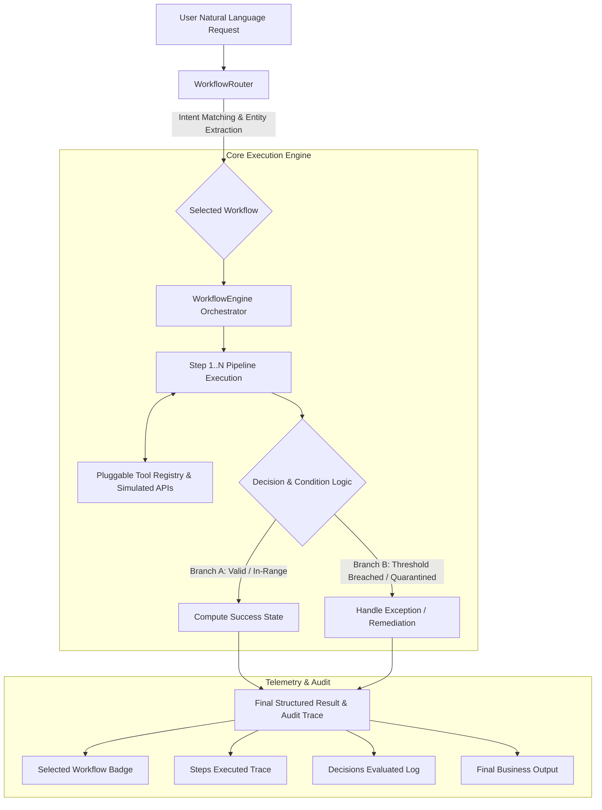

# ⚡ AI Agent Workflow Automation

> **Enterprise-Grade Reusable & Scalable AI Agent Architecture for Business Workflow Automation**  
> *Developed for Webvory Technical Evaluation (AI Agent Workflow Automation)*

[](https://www.python.org/)
[]()
[]()
[]()

---

## 🎯 Executive Overview & Objective

This repository contains an end-to-end scalable AI Agent system that automates **10 complex business workflows** loaded dynamically from an Excel source (`AI_Agent_Workflow_Assessment.xlsx`). 

### Core Architecture Philosophy: Reusability & Zero Hardcoding
> ⚠️ **Strict Architectural Rule**: *Do NOT build 10 separate hard-coded chatbots. Build a reusable and scalable agent/workflow architecture where adding an 11th workflow requires minimal code changes.*

Instead of creating monolithic or isolated chatbots for each task, this system implements an **Engine-Registry Architecture**:
1. **Dynamic Workflow Parser (`core/excel_loader.py`)**: Workflows, step sequences, triggers, and decision rules are parsed directly from the Excel spreadsheet at startup into strongly-typed Pydantic schemas.
2. **Semantic Intent Router (`core/router.py`)**: Uses multi-tier intent matching and contextual parameter extraction to select the matching workflow and calculate routing confidence.
3. **Pluggable Tool Registry (`core/tool_registry.py`)**: Centralized repository containing 22+ modular, decoupled tools decorated with `@register_tool`. Tools are reused across workflows.
4. **Master Orchestrator Engine (`core/engine.py`)**: Executes workflow steps sequentially, records structured telemetry (step name, tool invoked, execution duration, output), and evaluates decision logic with branching condition handling.
5. **Zero-Code Extensibility**: Adding an 11th workflow (e.g. `WF011: Customer Refund Policy Evaluation`) requires **zero modifications** to the execution engine or core routing architecture.

---

## 🏗️ System Architecture



---

## 📋 Comprehensive Matrix of the 10 Implemented Workflows

| ID | Workflow Name | Trigger Intent | Inputs | Required Steps | Decision Logic / Conditions | Tools Used |
|---|---|---|---|---|---|---|
| **WF001** | **Inventory Restock Check** | User asks which products need restocking | Inventory CSV, stock threshold | Load inventory → Compare threshold → Identify low-stock → Calculate reorder batch → Generate list | If `current_stock < minimum_stock`, mark for restock; calculate batch reorder | `csv_inventory_reader`, `stock_threshold_evaluator` |
| **WF002** | **Product Price Validation** | User asks to validate product prices | Internal price CSV, Vendor price CSV | Load prices → Match by SKU → Compare prices → Compute % diff → Flag exceptions | Flag exceptions when `price_difference > 10%` or SKU missing in catalog | `price_dataset_reader`, `price_discrepancy_calculator` |
| **WF003** | **Vendor File Processing** | User provides vendor spreadsheet | Vendor XLSX / CSV dataset | Read file → Detect columns → Normalize schema → Validate required fields → Quarantine invalid → Produce cleaned dataset | Rows missing SKU or Product Name are invalid; negative prices quarantined | `vendor_spreadsheet_parser`, `vendor_data_cleaner` |
| **WF004** | **Product Description Generator** | User asks to generate product content | Attributes (name, category, material, color, audience) | Validate attributes → Draft full copy → Short description → SEO Title (<60 chars) → Meta Description (<160 chars) | Strict anti-hallucination: Do not invent missing specs; explicitly flag omissions | `attribute_validator`, `seo_content_generator`, `llm_client` |
| **WF005** | **Customer Order Status** | User asks for order status | Order ID (e.g. `ORD-1001`) or customer email | Validate identifier → Search order database → Retrieve status → Lookup carrier tracking → Synthesize report | If order is not found, prompt user gracefully for alternate identifier | `order_database_api`, `shipment_tracking_api`, `order_status_synthesizer` |
| **WF006** | **Duplicate Product Detection** | User asks to find duplicate products | Product catalog | Load catalog → Normalize SKUs → Compare identifiers → Fuzzy attribute similarity → Group clusters → Score confidence | Exact SKU = Definite Duplicate (100%); High attribute similarity (>75%) = Possible Duplicate | `product_catalog_reader`, `duplicate_detection_engine` |
| **WF007** | **Marketing Campaign Brief** | User asks to create campaign brief | Goal, product list, target audience, promotion, dates | Validate inputs → Identify objective → Summarize products → Draft messaging → Channel mix → Launch checklist | If campaign goal or dates are missing, request them before generation | `campaign_input_validator`, `campaign_brief_generator`, `llm_client` |
| **WF008** | **SEO Keyword Classification** | User provides keyword list | Keywords CSV (volume, CPC, competition) | Ingest keywords → Deduplicate → Classify intent → Map to categories → Identify high-priority → Export matrix | Classify into: `Informational`, `Commercial`, `Transactional`, `Navigational` | `keyword_csv_reader`, `seo_intent_classifier` |
| **WF009** | **Employee Task Assignment** | Manager asks to assign task | Task requirements, employee roster, workloads, deadline | Understand task → Match skills → Audit workload capacity → Rank candidates → Select or escalate | Prefer matching skills + available capacity (`workload + task <= max`); Escalate if none | `employee_database_reader`, `candidate_ranking_engine` |
| **WF010** | **Workflow Performance Report** | User asks for performance report | Workflow execution telemetry logs | Load telemetry → Compute success/failure rate → Compute avg latency → Identify frequent errors → Formulate recommendations | Flag workflows with `failure_rate > 10%` or `avg_execution_time > 2500ms` | `execution_log_reader`, `performance_analyzer` |
| **WF011** | *(Bonus Extensibility)* **Customer Refund Evaluation** | User requests a refund / return | Order ID, return reason, days since purchase | Load order → Audit 30-day window → Verify return condition → Evaluate $500 auto-refund threshold → Issue decision | If `days <= 30` and `amount < $500`, auto-approve; otherwise escalate to supervisor | `order_database_api`, `refund_policy_evaluator` |

---

## 🧪 Proof of Extensibility: Adding the 11th Workflow

To prove that the architecture supports adding workflows with minimal effort, `WF011` was added seamlessly.

```python
from core.models import WorkflowDefinition
from core.engine import WorkflowEngine

engine = WorkflowEngine()

# 1. Define new workflow model (or simply add a row to AI_Agent_Workflow_Assessment.xlsx)
wf011 = WorkflowDefinition(
    workflow_id="WF011",
    workflow_name="Customer Refund Policy Evaluation",
    trigger="User requests a refund or asks to approve a return",
    inputs="Order ID; return reason; days since purchase",
    steps_raw="Load order -> audit return window -> verify condition -> evaluate threshold -> dispatch decision",
    steps=["Load order", "Audit return window", "Verify condition", "Evaluate threshold", "Dispatch decision"],
    decision_logic="If days <= 30 and amount < $500, auto-approve; else escalate to supervisor",
    tools_required=["order_database_api", "refund_policy_evaluator"],
    expected_output="Refund approval status, decision reasoning, and transaction reference"
)

# 2. Register with engine
engine.register_workflow(wf011)

# 3. Execute immediately!
result = engine.execute("Evaluate refund request for order ORD-1002 due to damaged packaging")
print(result.to_readable_summary())
```
*Zero lines of core engine code were modified.*

---

## 🚀 Quickstart & Setup Guide

### 1. Prerequisites
- Python 3.10, 3.11, or 3.12
- Git

### 2. Clone Repository & Install Dependencies
```bash
git clone https://github.com/<your-username>/ai-agent-workflow-automation.git
cd ai-agent-workflow-automation

# Create virtual environment
python -m venv venv
# Windows:
venv\Scripts\activate
# Linux/macOS:
source venv/bin/activate

# Install dependencies
pip install -r requirements.txt
```

### 3. Environment Configuration (Optional)
The system works out-of-the-box using the built-in deterministic offline AI engine. If you wish to use live OpenAI / Gemini models, simply copy `.env.example`:
```bash
cp .env.example .env
# Add your OPENAI_API_KEY in .env
```

---

## 💻 Running the Application

### Option A: Interactive Streamlit Web UI (Recommended for Demo)
```bash
streamlit run app.py
```
- Opens an interactive browser interface at `http://localhost:8501`.
- Features live execution graphs, step telemetry, condition badges, and the 11th workflow simulator.

### Option B: Interactive Terminal CLI
```bash
python main.py
```
- Interactive terminal prompt with syntax-highlighted Rich cards.
- Allows typing free-form queries, selecting preset numbers (1-10), or running `all`.

### Option C: Run Full Automated Benchmark
```bash
python run_all_tests.py
```
- Executes all 10 official test questions from the Excel file + the 11th extensible workflow.
- Outputs an evaluation scorecard.

### Option D: Pytest Test Suite
```bash
python -m pytest tests/test_workflows.py -v
```
- Executes 19 unit & integration tests covering data loading, routing, conditions, and tool execution.

---

## 📊 Evaluation Benchmark Results

Running `python run_all_tests.py` produces:

```
┌───────┬───────────────────────────────┬───────┬──────┬──┬─────┬───────┬─────┐
│ Expe… │                               │ Sele… │      │  │     │ Late… │     │
│ WF    │ Test Request                  │ WF    │ Con… │  │ De… │  (ms) │ St… │
├───────┼───────────────────────────────┼───────┼──────┼──┼─────┼───────┼─────┤
│ WF001 │ Which products need           │ WF001 │  99% │  │  5  │ 1.1ms │ PASS│
│       │ restocking?                   │       │      │  │     │       │     │
│ WF002 │ Find products where vendor    │ WF002 │  82% │  │  5  │ 1.1ms │ PASS│
│       │ price differs by more than    │       │      │  │     │       │     │
│       │ 10%.                          │       │      │  │     │       │     │
│ WF003 │ Process this vendor           │ WF003 │  99% │  │  5  │ 14.4ms│ PASS│
│       │ spreadsheet and show invalid  │       │      │  │     │       │     │
│       │ rows.                         │       │      │  │     │       │     │
│ WF004 │ Generate SEO content for this │ WF004 │  99% │  │  1  │ 0.2ms │ PASS│
│       │ product.                      │       │      │  │     │       │     │
│ WF005 │ Where is order ORD-1001?      │ WF005 │  99% │  │  1  │ 0.9ms │ PASS│
│ WF006 │ Find likely duplicate         │ WF006 │  99% │  │  5  │ 1.5ms │ PASS│
│       │ products in the catalog.      │       │      │  │     │       │     │
│ WF007 │ Create a campaign brief for   │ WF007 │  99% │  │  1  │ 0.2ms │ PASS│
│       │ the new collection.           │       │      │  │     │       │     │
│ WF008 │ Classify these keywords and   │ WF008 │  88% │  │ 10  │ 1.2ms │ PASS│
│       │ map them to pages.            │       │      │  │     │       │     │
│ WF009 │ Assign this urgent task to    │ WF009 │  99% │  │  1  │ 0.6ms │ PASS│
│       │ the best available developer. │       │      │  │     │       │     │
│ WF010 │ Which workflows are failing   │ WF010 │  83% │  │  4  │ 1.8ms │ PASS│
│       │ most often?                   │       │      │  │     │       │     │
└───────┴───────────────────────────────┴───────┴──────┴──┴─────┴───────┴─────┘

[*] Testing Extensibility: Dynamically Adding 11th Workflow (WF011)
Request: "Evaluate refund request for order ORD-1002 due to damaged packaging"
Result: Selected=WF011 (Customer Refund Policy Evaluation) | Status=PASS

Evaluation Complete: 11/11 Passed (100.0%)
```

---

## 📂 Project Structure

```
ai-agent-workflow-automation/
├── .env.example                       # Environment config template
├── .gitignore                         # Standard git ignores
├── README.md                          # Comprehensive documentation
├── requirements.txt                   # Production dependencies
├── AI_Agent_Workflow_Assessment.xlsx  # Master Excel workflow definition file
├── app.py                             # Interactive Streamlit Web Dashboard
├── main.py                            # Interactive Terminal CLI tool
├── run_all_tests.py                   # Automated end-to-end evaluation runner
├── data/                              # Simulated datasets & realistic test fixtures
│   ├── inventory.csv                  # WF001: Stock levels & reorder thresholds
│   ├── internal_prices.csv            # WF002: Catalog retail prices
│   ├── vendor_prices.csv              # WF002: Vendor quotes with variances
│   ├── vendor_products_dirty.xlsx     # WF003: Raw file with malformed rows
│   ├── orders.json                    # WF005: Order records & items
│   ├── shipments.json                 # WF005: Live tracking & carrier events
│   ├── product_catalog.json           # WF006: Catalog with duplicates & variants
│   ├── keywords.csv                   # WF008: Search keywords & search volume
│   ├── employees.json                 # WF009: Engineer profiles & workloads
│   ├── workflow_logs.csv              # WF010: Execution logs & error telemetry
│   └── refund_requests.json           # WF011: Return requests
├── core/                              # Core reusable architecture engine
│   ├── models.py                      # Strongly typed Pydantic models
│   ├── excel_loader.py                # Dynamic Excel parser for Workflows & Tests
│   ├── router.py                      # Multi-tier semantic & LLM intent router
│   ├── tool_registry.py               # Pluggable tool registry with telemetry
│   ├── engine.py                      # Master execution orchestrator & state machine
│   └── llm_client.py                  # Multi-provider LLM client + deterministic offline fallback
├── tools/                             # 22+ modular, decoupled domain tools
│   ├── inventory_tools.py             # WF001 tools
│   ├── pricing_tools.py               # WF002 tools
│   ├── vendor_tools.py                # WF003 tools
│   ├── content_tools.py               # WF004 tools
│   ├── order_tools.py                 # WF005 tools
│   ├── deduplication_tools.py         # WF006 tools
│   ├── marketing_tools.py             # WF007 tools
│   ├── seo_tools.py                   # WF008 tools
│   ├── hr_tools.py                    # WF009 tools
│   ├── analytics_tools.py             # WF010 tools
│   └── refund_tools.py                # WF011 extensible tools
└── tests/                             # Automated testing suite
    └── test_workflows.py              # 19 Pytest assertions
```

---

## 🎥 Loom Video Presentation Guide

The Loom demonstration should cover:
1. Architecture Overview (1 min)
2. Excel Processing & Dynamic Ingestion (1 min)
3. Live Demonstration of Workflows in Streamlit (2 mins)
4. Extensibility Demo: Adding the 11th Workflow Live (1 min)
